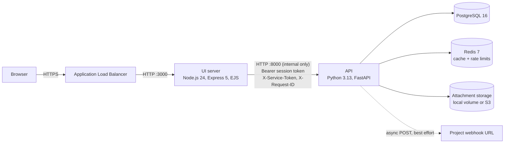
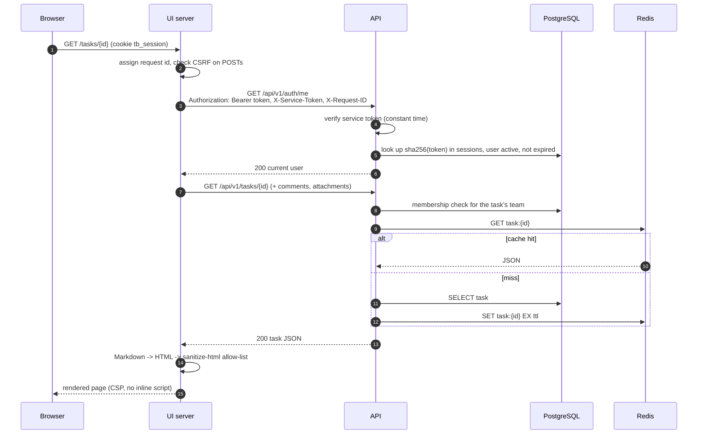
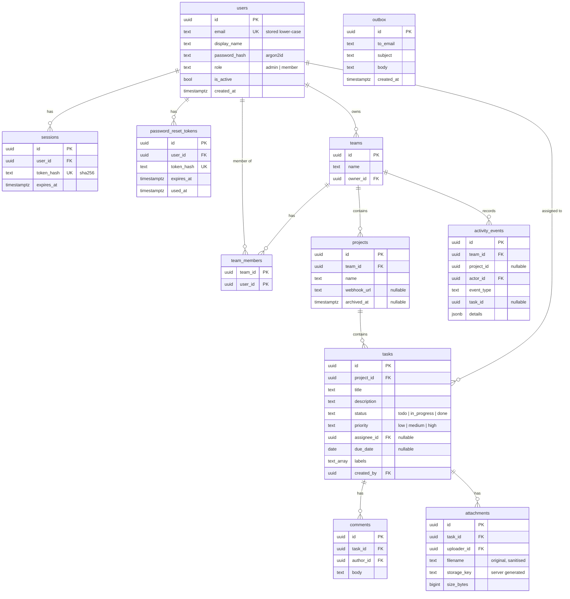

# Taskboard architecture

Taskboard is a small internal task tracker. This document describes the components, how a request flows through
them, the authentication design, the data model and the caching strategy. Design decisions and their reasons are in
[DECISIONS.md](DECISIONS.md); the threat model is in [threat-model.md](threat-model.md).

## Components



| Component | Responsibility | Talks to |
| --- | --- | --- |
| UI server (`ui/`) | Renders HTML pages, owns the browser cookie, CSRF protection, Markdown rendering and sanitising, proxies attachment uploads and downloads | API only |
| API (`api/`) | All business rules, authentication, authorization, persistence, caching, storage, outbound webhooks, outbox mail | PostgreSQL, Redis, storage, webhook targets |
| PostgreSQL | System of record | API |
| Redis | Cache-aside read cache and login/forgot-password rate-limit counters. Optional: the API degrades to no cache and in-process rate limits | API |
| Attachment storage | File bytes under server-generated keys. `LocalFileStorage` in dev, `S3Storage` in AWS, behind one `AttachmentStorage` interface | API |

The API is never published to the host or the internet. In Docker Compose only the UI port is mapped; in AWS the
API instances are in private subnets and their security group admits port 8000 only from the UI security group.

## Request flow



Layering inside each service:

- **API**: `api` (FastAPI routers and Pydantic request/response schemas) → `services` (business rules, access policy)
  → `repositories` (Protocol interfaces, SQLAlchemy implementations) → `models` (SQLAlchemy ORM). Domain entities
  are frozen dataclasses in `domain`, and domain errors are typed exceptions in `domain/errors.py`, mapped to HTTP
  responses in one exception handler module. All wiring happens in `composition.py`, and routers get services
  through FastAPI `Depends`.
- **UI**: `ApiClient` (the only code that calls the API) → controllers (one class per area) → view-model builders →
  EJS views. Middleware classes handle request ids, logging, sessions, CSRF, flash messages and errors. Wiring
  happens in `src/composition.ts`.

Every log line in both services is JSON and carries the request id. The UI generates a UUID per incoming request and
sends it to the API as `X-Request-ID`; the API accepts it if it matches a strict pattern, otherwise generates its own.

## Authentication design

```mermaid
sequenceDiagram
  autonumber
  participant B as Browser
  participant U as UI server
  participant A as API
  B->>U: POST /login (email, password, _csrf)
  U->>U: verify CSRF token
  U->>A: POST /api/v1/auth/login {email, password}<br/>X-Service-Token, X-Client-IP
  A->>A: rate limit per email and per client IP
  A->>A: Argon2id verify, user active
  A->>A: token = secrets.token_urlsafe(32), store sha256(token) + expiry
  A-->>U: 200 {token, expires_at, user}
  U-->>B: Set-Cookie tb_session=token; HttpOnly; SameSite=Lax; Secure (prod, __Host- prefix)
  Note over U,A: later requests: Authorization: Bearer token
  B->>U: POST /logout
  U->>A: POST /api/v1/auth/logout (Bearer token)
  A->>A: delete session row
  U-->>B: clear cookie
```

- **Session tokens are opaque and server-side.** The API issues a 256-bit random token at login and stores only its
  SHA-256 hash with an absolute expiry (`SESSION_TTL_SECONDS`, default 8 hours). The raw token lives in the browser's
  `HttpOnly` cookie and in the UI-to-API `Authorization` header, nowhere else. Each login creates a new token, so a
  planted token cannot survive login.
- **Identity is never taken from a header.** The API resolves the caller from the bearer token on every request and
  rejects inactive users. Logout deletes the session. Password change, password reset and deactivation delete all of
  the user's sessions.
- **The UI proves it is the UI.** Every API request except `/healthz` and `/readyz` must carry `X-Service-Token`,
  a shared secret compared in constant time. This keeps other workloads on the internal network from using the API
  even if they obtain a user token, and lets the API trust `X-Client-IP` for rate limiting.
- **CSRF.** The UI sets an `HttpOnly` random `tb_csrf` cookie and embeds `HMAC-SHA256(COOKIE_SECRET, cookie value)`
  in every form as `_csrf`. Every POST is checked in middleware before any controller runs. Session cookies are also
  `SameSite=Lax`.
- **Passwords** are hashed with Argon2id (`argon2-cffi` defaults). Length 12 to 128 characters, no composition rules.
- **Password reset.** `POST /auth/password/forgot` always answers `202` with the same body. For an active account it
  creates a `secrets.token_urlsafe(32)` token, stores its SHA-256 with a 30-minute expiry, and "sends" an email whose
  link is built from the configured `PUBLIC_BASE_URL` (never from request headers). Emails go to the API log and the
  `outbox` table. A token works once; using it sets the new password and revokes every session.
- **Rate limits.** Login: 5 failures per email and 20 attempts per client IP per 15 minutes. Forgot-password and
  register: per client IP. Counters live in Redis and fall back to an in-process limiter if Redis is down.
- **Roles.** `member` (default at registration) and `admin`. Admins are created only by the `create-admin`
  management command (email and password from environment variables) or promoted by another admin. Admins cannot
  demote or deactivate themselves.

## Authorization model

| Action | Who |
| --- | --- |
| See a team, its members and projects | Team members, admins |
| Add or remove team members | Team owner, admins |
| Create, rename, archive a project; set its webhook URL | Team owner, admins |
| Create, edit, delete tasks; comment; upload attachments | Team members (and admins) on active projects |
| Edit or delete a comment | Its author |
| List users, change roles, deactivate users, global activity, cache stats | Admins |

All checks run in the API's service layer through one `AccessPolicy`. A caller who is not allowed to see an object
gets `404`, so ids of other teams' objects are not confirmed. Search and list queries are always scoped to the teams
the caller belongs to, in the repository query itself.

## Data model



All ids are UUIDv4. Every table has `created_at`, and mutable tables have `updated_at`. Deleting a task cascades to its
comments and attachments, and the service deletes the attachment bytes from storage after the database commit.
Activity events for team membership have no `project_id`; a project's feed shows its own events plus its team's
membership events.

## API contract

The API is versioned under `/api/v1`. FastAPI generates the OpenAPI document, served at `/api/v1/openapi.json`
behind the service token like every other `/api/v1` route; there is no interactive docs UI. The endpoint list matches section 4.7 of the brief, plus
`GET /api/v1/admin/cache/stats` (admin only) for cache counters. Conventions:

- JSON bodies validated by Pydantic models with `extra="forbid"`; unknown fields are a `422`.
- Errors use one shape: `{"error": {"code": "not_found", "message": "...", "request_id": "..."}}`.
- Lists use `page` (1-based) and `page_size` (1 to 200, default 50) and return `{items, total, page, page_size}`.
- Sorting uses `sort` (one of the task fields `title, status, priority, due_date, created_at, updated_at, assignee`)
  and `order` (`asc` or `desc`), validated against enums.
- Timestamps are ISO 8601 UTC.

| Domain error | HTTP |
| --- | --- |
| `ValidationFailed` | 422 |
| `AuthenticationRequired`, `InvalidCredentials` | 401 |
| `PermissionDenied` | 403 |
| `NotFound` | 404 |
| `Conflict` (e.g. email already registered) | 409 |
| `ProjectArchived` | 409 |
| `PayloadTooLarge` | 413 |
| `RateLimited` | 429 |

## Caching

Cache-aside in the API through a `Cache` interface with `RedisCache`, `InMemoryCache` (tests) and `NullCache`
implementations. Values are JSON, never pickled.

| Key | Contents | Invalidated by |
| --- | --- | --- |
| `user:{id}` | user profile | password change, role change, activation change |
| `user:{id}:teams` | the user's teams | team created, member added or removed (for that user) |
| `user:{id}:projects` | the user's projects | project created, renamed or archived (all team members), member added or removed |
| `task:{id}` | task detail | task updated or deleted |
| `project:{id}:tasks:v{n}:{hash(filters)}` | one page of a project's task list for one filter/sort/page combination | any task write in the project increments `project:{id}:tasks:ver`, so every older combination becomes unreachable |

- Authorization always runs against the database before a cached value is returned, so a stale entry can never widen
  access.
- TTL (`CACHE_TTL_SECONDS`, default 300) is only a backstop.
- Every write invalidates its keys after the database commit.
- Hits and misses are logged at debug level, and per-family counters are exposed at `GET /api/v1/admin/cache/stats`.
- Every Redis operation is wrapped: on a Redis error the cache logs a warning and behaves as a miss (reads) or no-op
  (writes), so the API keeps working without Redis.

## Outbound webhooks

When a task's status changes, the task service publishes a `task.status_changed` event after commit. The
`HttpWebhookNotifier` queues delivery on a small thread pool, so the request that changed the status returns
immediately. Delivery is best effort: up to 3 attempts with short backoff, 3-second connect and read timeouts.

Payload:

```json
{
  "event": "task.status_changed",
  "task_id": "…",
  "project_id": "…",
  "old_status": "todo",
  "new_status": "done",
  "actor_id": "…",
  "timestamp": "2026-10-18T09:14:03Z"
}
```

The URL is checked when it is saved and again before every attempt. Only `https` is accepted (unless
`WEBHOOK_ALLOW_HTTP=true` for local testing). The host is resolved, and every resolved address must be public: no
loopback, private, link-local (including `169.254.169.254`), CGNAT, multicast or reserved ranges. The request goes to
the validated address with the original `Host` header and TLS SNI, so a DNS answer cannot change between check and
connect. Redirects are not followed, TLS certificates are always verified, and at most 64 KiB of the response is
read. Each request carries `X-Taskboard-Signature: sha256=<HMAC of the body>` keyed by `WEBHOOK_SIGNING_SECRET`.

## Attachments

- Upload: the UI accepts one multipart file up to 10 MB (multer limit), then streams it to the API. The API enforces
  the same limit with a body-size middleware and a byte counter while writing. The bytes go to storage under a key
  `attachments/{uuid}` generated by the API. The original filename is kept only as metadata, reduced to its base name,
  with control characters removed and its length capped.
- Download: the API returns the bytes with `Content-Type: application/octet-stream`,
  `Content-Disposition: attachment; filename="<ascii fallback>"; filename*=UTF-8''<percent-encoded>`,
  `X-Content-Type-Options: nosniff`, and `Content-Security-Policy: sandbox`. The UI streams the response through
  with the same headers.

## Markdown

The API stores Markdown as plain text. The UI renders it with `marked` and then passes the HTML through
`sanitize-html` with an allow-list of formatting tags. Links may only use `http`, `https` or `mailto`, and get
`rel="noopener noreferrer nofollow"`. Images are not allowed. Every other value is escaped by EJS. The UI's CSP is
`default-src 'self'` with no inline script.
