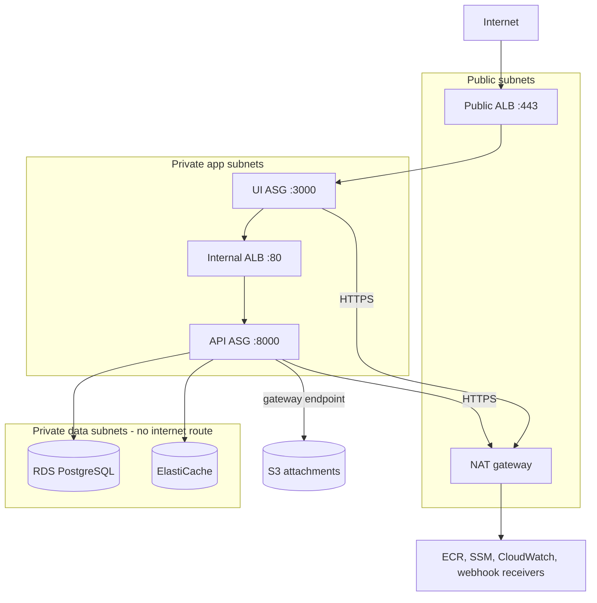

# Deploying Taskboard to AWS

Everything here is defined in Terraform under [`infra/`](../infra). Nothing in this repository has been applied to a
real AWS account; `make tf-check` (format, init without backend, validate) is the only check run.

## Terraform layout

```
infra/
├── modules/
│   ├── network    VPC over two AZs: public subnets (ALB, NAT), private app subnets (EC2), private data subnets
│   │              (RDS, ElastiCache; no internet route), NAT gateway, route tables, S3 gateway endpoint, flow logs
│   ├── alb        Public ALB: HTTPS (TLS 1.2+ policy) → UI target group; HTTP → 301 to HTTPS
│   ├── ui         Launch template + Auto Scaling group for the UI in app subnets; SG admits only the ALB
│   ├── api        Internal ALB + launch template + Auto Scaling group for the API; only the UI SG may call it
│   ├── database   RDS PostgreSQL 16: encrypted (CMK), forced TLS, RDS-managed master secret, backups
│   ├── cache      ElastiCache (Valkey by default, Redis OSS supported): TLS required, AUTH token, CMK, LRU eviction
│   ├── storage    S3 attachments bucket: Block Public Access, SSE-KMS (CMK), TLS-only policy, versioning, lifecycle
│   ├── registry   ECR repositories <name>/ui and <name>/api: immutable tags, scan on push, KMS
│   └── iam        Per-service instance roles and profiles, config KMS key, CloudWatch log groups
└── envs/dev/
    ├── versions.tf               providers (AWS 6.x, random) and the partial S3 backend
    ├── main.tf                   module composition
    ├── secrets.tf                generated secrets and SSM runtime configuration
    ├── variables.tf / outputs.tf
    ├── backend.hcl.example       copy to backend.hcl
    └── terraform.tfvars.example  copy to terraform.tfvars
```



## How images, configuration and credentials reach the instances

- **Images** are built from the two Dockerfiles and pushed to the ECR repositories that Terraform creates, tagged with
  an immutable tag such as the git SHA (`latest` is rejected by validation). `ui_image_tag` and `api_image_tag` select
  what the instances run.
- **Configuration and secrets** live in SSM Parameter Store under `/<project>/<environment>/ui/*` and `.../api/*`.
  `envs/dev/secrets.tf` writes them: plain values as `String`, secrets as `SecureString` encrypted with the config KMS
  key. The secrets (service token, cookie secret, webhook signing secret, Redis AUTH token, application DB password)
  are generated with `random_password`, never typed into tfvars or committed.
- **Credentials** are never static: each instance has an IAM role (temporary credentials via IMDSv2, hop limit 1). The
  UI role can pull its own image, read and decrypt only `/…/ui/*`, and write its own log group. The API role can do the
  same for `/…/api/*` and can read, write and delete objects only under `attachments/` in the bucket. Decryption is tied
  to each service's parameter ARNs through the KMS encryption context, so neither role can read the other's secrets
  (F-090). Shell access is through SSM Session Manager; there are no SSH keys or open SSH ports.
- **Boot** (`modules/{ui,api}/templates/user_data.sh.tftpl`): install Docker, log in to ECR, write the service's
  parameters to a root-only env file, then run the container read-only with all capabilities dropped,
  `no-new-privileges`, memory and PID limits, and the `awslogs` log driver. The API instance also downloads the RDS CA
  bundle for `sslmode=verify-full`. The UI container uses bridge networking, so it cannot reach the metadata service.
  The API container uses host networking because it needs its role for S3.
- **Configuration changes** change a fingerprint on the launch template, so the Auto Scaling group's instance refresh
  rolls them out.

## Deploying end to end

1. **Prerequisites:** an AWS account, an ACM certificate for the public hostname, and an S3 bucket plus KMS key for
   Terraform state, restricted to the deploy role. The state contains the generated secrets.
2. **Configure:**
   ```bash
   cd infra/envs/dev
   cp backend.hcl.example backend.hcl
   cp terraform.tfvars.example terraform.tfvars
   ```
   Edit both files, then initialise:
   ```bash
   terraform init -backend-config=backend.hcl
   ```
3. **Create the registry first** so images can be pushed:
   ```bash
   terraform apply -target=module.registry
   ```
   Then build and push both images with an immutable tag:
   ```bash
   docker build -t "$ECR_UI:$GIT_SHA" ui && docker push "$ECR_UI:$GIT_SHA"
   ```
   ```bash
   docker build -t "$ECR_API:$GIT_SHA" api && docker push "$ECR_API:$GIT_SHA"
   ```
4. **Apply everything** with `ui_image_tag` / `api_image_tag` set to that tag: `terraform apply`. Point the public DNS
   name at the `alb_dns_name` output (alias record using `alb_zone_id`).
5. **Migrate and create the application database role** as a one-off job from an operator session (SSM Session Manager
   on an API instance, or a CI runner inside the VPC) using the API image. Read the owner credentials from the
   `database_master_secret_arn` output and the app password from `/<project>/<env>/migrate/DB_APP_PASSWORD`. No instance
   role can read either one.
   ```bash
   docker run --rm --network host \
     -e MIGRATION_DATABASE_URL="postgresql+psycopg://taskboard_owner:<master>@<db>:5432/taskboard?sslmode=verify-full&sslrootcert=/etc/ssl/rds-ca.pem" \
     -e DB_APP_PASSWORD="<from SSM>" \
     -v /etc/taskboard/rds-ca.pem:/etc/ssl/rds-ca.pem:ro \
     "$ECR_API:$GIT_SHA" taskboard-admin migrate
   ```
   This applies the Alembic migrations as the owner and (re)creates `taskboard_app` with row-level privileges only. The
   API connects as `taskboard_app`, so it cannot change the schema.
6. **Create the first admin** the same way with `taskboard-admin create-admin`, passing `ADMIN_EMAIL` and
   `ADMIN_PASSWORD` (12+ characters) as environment variables for that one command, plus the API's runtime environment.
7. **Check:** `https://<public_hostname>/healthz` (UI) and the target group health. The UI's `/readyz` also checks that
   the API is ready.
8. **Releases:** push new images, change the tags, and run `terraform apply`. The new launch template version triggers
   a rolling instance refresh (at least 50 % healthy). Run step 5 first when a release contains migrations.

## Operational notes

- **Secret rotation:** taint the relevant `random_password` and apply. The SSM values and launch template fingerprint
  change, and instances roll. The RDS master password is rotated by RDS in Secrets Manager.
- **Logs:** each container logs JSON (with request ids) to `/<project>-<env>/ui` and `/<project>-<env>/api` in
  CloudWatch, encrypted with the config key. VPC flow logs go to `/vpc/<project>-<env>/flow-logs`.
- **Accepted gaps:** no WAF, and ALB/S3 access logs are off by default (F-091). The UI→internal ALB→API hop is HTTP
  inside private subnets that only the UI security group can reach (F-004). Generated secrets are in Terraform state,
  which must stay in the encrypted, access-restricted backend (F-092).
